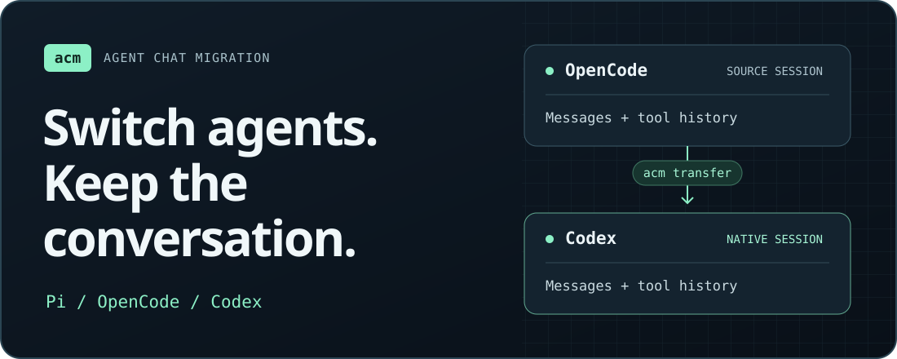

# acm — Agent Chat Migration



Pick up an existing coding conversation in **Pi, OpenCode or Codex**. `acm` reads the source agent’s stored history and writes a new session into the destination agent’s native storage.

**Six transfer directions · Local and offline · Existing sessions stay intact**

[**Quick start →**](#quick-start) · [What travels with a session](#what-travels-with-a-session) · [CLI reference](#commands)

## Quick start

Install with one command. The installer reuses Node.js 22.5+ with npm when available and downloads a private Node.js runtime when needed on macOS or Linux (arm64 and x64).

```bash
curl -fsSL https://raw.githubusercontent.com/GenryEden/acm/main/install.sh | sh
```

### Continue an OpenCode session in Codex

List your OpenCode sessions across projects.

```bash
acm list --agent opencode --all
```

```text
/Users/test/project (1 session)

AGENT     SESSION ID             TITLE                   LAST ACTIVITY
--------  ---------------------  ----------------------  --------------------
opencode  ses_sample0001session  Please read src/app.ts  2026-01-01 10:00:08Z
```

Copy the session ID into the transfer command.

```bash
acm transfer --from opencode --session ses_sample0001session --to codex
```

The report starts with the new session ID. Use it to open the conversation in Codex.

```text
Transferred to codex: session 01a1f3cb-bd9e-7ae0-92aa-adbbb273c32e
  messages:        3 (user: 1, assistant: 2)
  tool calls:      1
```

### Share a session with someone else

Export the same OpenCode session to a portable file.

```bash
acm export --agent opencode --session ses_sample0001session --out session.acm.jsonl
```

The file can include raw tool output, so review it before sending it. The recipient can import `session.acm.jsonl` from their own project directory and open the new session in Codex.

```bash
acm import session.acm.jsonl --to codex --project "$PWD"
```

## What travels with a session

Transferred (when the receiver can store it natively):
- user and assistant messages (full text, never truncated)
- assistant thinking/reasoning
- tool calls with arguments **and** results (kept inseparable)
- file changes (opencode native `patch` parts)

Skipped — listed in the transfer report, never converted to plain text:
- history kinds the receiver's schema cannot express natively (e.g. `file_change` → pi/codex, `service_event` → anywhere)

Out of scope by design:
- agent configuration: model, system prompt, MCP servers, tools
- usage metadata (token counts)

**We only transfer what the source actually stored.** If the source agent did not persist reasoning or file diffs, they cannot be recovered.

Original file paths inside the history are never rewritten; `--project` only controls where the new session is placed. Imports are strictly additive: existing sessions are never modified, and failed writes leave the receiver's storage untouched.

## Supported agents and formats

| Agent | Storage (read + write) | Format version detection |
|---|---|---|
| pi | `~/.pi/agent/sessions/<cwd-slug>/*.jsonl` (event JSONL) | `version` field in the session record (supported: v3) |
| opencode | `~/.local/share/opencode/opencode.db` (SQLite: `session`/`message`/`part`/`session_message`) | required tables present |
| codex | `~/.codex/sessions/YYYY/MM/DD/rollout-*.jsonl` + `~/.codex/session_index.jsonl` | rollout structure |

Transfer sessions in either direction between any pair of agents.

## Commands

```bash
acm list [--agent <pi|opencode|codex>] [-A|--all] [--project <dir>] [--json]
acm export --agent <agent> --session <id> [--out <file>] [--force]
acm import <file.acm.jsonl> --to <agent> [--project <dir>] [--force] [--json]
acm transfer --from <agent> --session <id> --to <agent> [--project <dir>] [--out <file>] [--force] [--json]
```

### `list` scoping

- **Default**: only sessions whose `cwd` is the current working directory or
  nested under it (subtree match). Sessions without a recorded `cwd` are hidden.
- **`-A` / `--all`**: all sessions, grouped by project directory (one table per
  project; sessions without a `cwd` are grouped under `(unknown project)`).
- **`--project <dir>`**: subtree filter — `cwd` equal to `<dir>` or nested under
  it. Takes precedence over the default scope; combined with `-A` it filters
  that view. Paths are compared lexically after normalization (`..`, `.`,
  trailing `/`), without resolving symlinks.
- **`--json`**: always a flat array of session records (grouping is
  presentation-only for human output).

### Exit codes

| Code | Meaning |
|---|---|
| 0 | success (including "no sessions found" for `list`) |
| 1 | usage error (unknown command/agent, missing required flag) |
| 2 | write failure — receiver storage left unchanged |
| 3 | invalid/incompatible package (with line number and expected formatVersion) |
| 4 | source session not found |
| 5 | output file exists without `--force` |
| 6 | history exceeds recommended size — rerun with `--force` |

## Transfer package format

`*.acm.jsonl` — JSONL: first line is the header (`recordType: "package"`, `formatVersion: 1`, source agent/session, cwd), each following line is one history item (`recordType: "item"`). Hand-inspectable, streamable, portable between machines.

## Development

```bash
npm test          # unit, contract and sandboxed integration tests
npx tsc --noEmit  # type-check
```

Tests run against sanitized fixtures in `tests/fixtures/` and sandboxed `$HOME` copies (`ACM_HOME`); they never touch your real agent storages.

## Adding a new agent

Implement the `AgentAdapter` interface (`src/adapters/types.ts`): `listSessions`, `exportSession`, `importSession`, `capabilities.itemKinds`, `storagePath`. Register it in `src/core/registry.ts`. No core changes needed.
